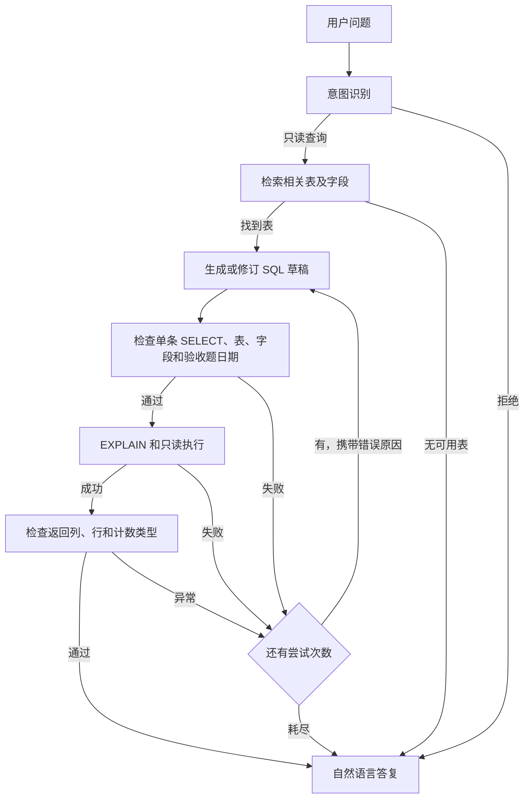

# LangGraph SQL Agent · 员工库作业

用户提交自然语言问题后，LangGraph 识别查询意图，获取相关表的 MySQL schema，生成并校验 SQL。通过后先运行 `EXPLAIN`，再执行查询。SQL 校验、执行或结果检查失败时，带着失败原因回到草稿节点，默认最多生成三次。



| 文件 | 用途 |
|---|---|
| `agent.py` | LangGraph 节点、条件边、MySQL 执行、模型和命令行入口 |
| `db.py` | 数据库连接与允许访问的课堂表 |
| `import_employees.py` | 把原始 Navicat 导出导入空库，批量插入并创建只读账号 |
| `verify.py` | 核对验收题、写权限和两条重生成回路 |
| `compose.yaml`、`.env.example` | MySQL 8.4 容器、端口和连接配置模板 |

## 1. 准备 MySQL

在项目目录中将 `.env.example` 复制为 `.env`。给 `MYSQL_ROOT_PASSWORD` 和 `SQL_AGENT_PASSWORD` 分别填写自定义密码。保持数据库名为 `47` 时，本机连接地址为 `127.0.0.1:13307`。Compose 将这个地址映射到容器的 3306，并用命名卷保存数据。

```powershell
Copy-Item .env.example .env
# 编辑 .env，填写两个密码后再启动
docker compose up -d
docker compose logs --tail 25 mysql
```

等 MySQL 完成初始化并监听 3306，再选择以下一种导入方式。Compose 采用 [Docker 官方 MySQL 镜像](https://hub.docker.com/_/mysql)。课程另有指定镜像源时，按课堂提供的地址调整镜像引用。

先安装 Python 依赖。课程环境已有 LangGraph 和模型依赖时，可给该环境补装 `sqlglot` 和 `PyMySQL[rsa]`。也可以在有 Python 3.11 的环境中单独安装。

```powershell
py -3.11 -m venv .venv
& .\.venv\Scripts\python.exe -m pip install -r requirements.txt
```

**命令行导入。** 这是自动化方式。输入原始课堂文件的路径即可。脚本会检查目标库为空，导入六张表，再创建独立的查询账号。

```powershell
& .\.venv\Scripts\python.exe .\import_employees.py 'D:\project\step1\week24\employees.sql'
```

**Navicat 导入。** 连接 `127.0.0.1:13307`，用管理员新建空库 `47`，对空库使用“运行 SQL 文件”导入原文件。导入后用管理员创建 Agent 账号，并授予六张课堂表的 SELECT 权限。把下例的密码占位文字换成 `.env` 中配置的查询账号密码。

```sql
CREATE USER 'sql_agent_reader'@'%' IDENTIFIED BY '填写自己的查询账号密码';
GRANT SELECT ON `47`.`employees` TO 'sql_agent_reader'@'%';
GRANT SELECT ON `47`.`departments` TO 'sql_agent_reader'@'%';
GRANT SELECT ON `47`.`dept_emp` TO 'sql_agent_reader'@'%';
GRANT SELECT ON `47`.`dept_manager` TO 'sql_agent_reader'@'%';
GRANT SELECT ON `47`.`salaries` TO 'sql_agent_reader'@'%';
GRANT SELECT ON `47`.`titles` TO 'sql_agent_reader'@'%';
```

原文件包含六张表的 `DROP TABLE IF EXISTS`，请选择空库导入。文件约 305 MB，由近 392 万条单行插入组成。自动化脚本按表合并批次，并在导入后打印各表行数和验收题基准。

## 2. 跑验收题

先用剧本模式验证图和真实 MySQL。剧本模式只支持课堂验收题。随后传入课程配置目录，使用配置中的模型执行意图识别和 SQL 生成。

```powershell
& .\.venv\Scripts\python.exe .\agent.py
& .\.venv\Scripts\python.exe .\agent.py --lab-dir 'D:\project\step1\week23\20261027'
& .\.venv\Scripts\python.exe .\agent.py '按性别统计员工人数' --lab-dir 'D:\project\step1\week23\20261027'
```

程序逐个打印节点、通过校验的 SQL、MySQL 执行计划和最终结果。模型接收问题、表及字段说明，以及必要时的前一轮校验反馈。应用在本地根据数据库返回值组织答复。

**验收题口径。** “1987 年之后”按自然年解释，从 1988 年 1 月 1 日当天起算。`employees.emp_no` 是主键，直接在员工表统计即可。

```sql
SELECT COUNT(*) AS employee_count
FROM employees
WHERE hire_date >= '1988-01-01';
```

原始文件中有 **300,024** 条员工记录，符合条件的有 **195,057** 人，含 1988 年 1 月 1 日当天入职的 **96** 人。

## 3. 验证失败回路

```powershell
& .\.venv\Scripts\python.exe .\verify.py
```

| 尝试 | 测试输入 | 预期行为 |
|---|---|---|
| 1 | 草稿使用不存在的 `join_date` | SQL 校验失败，直接回到草稿，执行节点跳过 |
| 2 | SQL 正确，数据库真实执行后注入异常空结果 | 结果校验失败，带错误原因回到草稿 |
| 3 | SQL 与结果都有效 | 返回 195,057 人 |

额外检查写入权限被数据库拒绝、`COUNT(*) = 0` 是合法结果、重试耗尽会停止。

## 4. 实现范围

SQL 校验解析 MySQL 语法树，并检查单条 SELECT、表和列、函数与查询子句。查询执行使用单独的 SELECT 账号、只读事务、服务器执行超时和列表上限。验收题额外检查员工表、COUNT 和日期边界。其他问题使用通用结构检查，验收时可对重要问题补充类似的业务规则。

这版支持六张课堂表上的常见过滤、连接、分组、排序与聚合。分组或列表最多展示 50 行。验证脚本使用剧本模型检查条件边，真模型运行用于检查意图识别和草稿生成。

参考 [LangGraph 自定义 SQL Agent](https://docs.langchain.com/oss/python/langgraph/sql-agent) 和 [MySQL EXPLAIN](https://dev.mysql.com/doc/refman/8.4/en/explain.html)。

## 本机验收记录

2026-11-08 在 Docker MySQL 8.4.13（Linux）上导入原始 SQL。容器映射 `127.0.0.1:13307 → 3306`，库名 `47`。六张表共导入 **3,919,015** 行。课程配置中的真模型生成了 `COUNT(*)` 和 `hire_date >= '1988-01-01'`，经过 SQL 校验、EXPLAIN、执行和结果校验，返回 **195,057 人**。`verify.py` 的两条修订回路、次数耗尽和只读权限检查均通过。

本机已启动的作业数据库保留在容器 `codex-lg-sql-employees-20261108-mysql-1`。下列命令可使用本机的课程环境直接复跑。连接配置保存在本机工作目录中，发给他人的作业包使用上面的 `.env.example` 模板配置。

```powershell
$env:PYTHONPATH = 'E:\Codex\2026-11-04\new-chat\work\sql_agent_deps'
& 'D:\project\step1\week23\.venv\Scripts\python.exe' 'E:\Codex\2026-11-04\new-chat\outputs\langgraph-sql-agent\agent.py' --env-file 'E:\Codex\2026-11-04\new-chat\work\sql_agent_local.env' --lab-dir 'D:\project\step1\week23\20261027'
```
