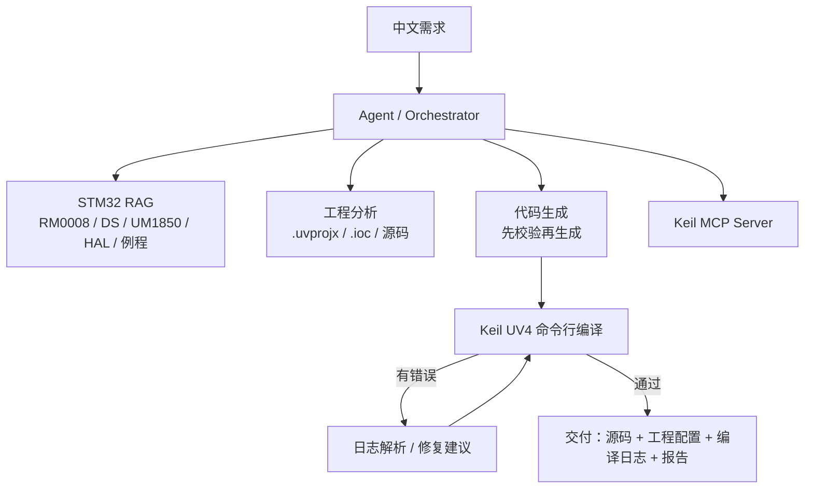

# 面试讲稿：STM32 AI 开发助手（`stm32_rag`）

> 用法：先背 **30 秒版**开场；技术面用 **2 分钟版 + 6 个钩子**；被追问时查第 5 节 Q&A。
> 文中所有数字都来自实际运行，见第 10 节「数字卡」。

---

## 0. 一句话定位

> 我做了一个面向 STM32 的 AI 开发助手：用 RAG 把 RM0008 手册、HAL 源码做成可溯源知识库，
> 用 Agent 把中文需求转成代码，再调 Keil 命令行编译、读错误日志自动修复，最终交付一个能编译通过的工程。

关键词：**RAG · Agent / 工具调用 · 代码生成 · 编译闭环 · 交付物**。

---

## 1. 30 秒版（HR / 综合面）

> 这是一个把大模型接到嵌入式工具链里的项目。用户说一句“配置 PA8 输出 1MHz PWM”，
> 它会先查手册确认引脚复用和时钟，生成 HAL 代码，再调用 Keil 编译，编译失败会自己看日志修；
> 最后交付源码、工程配置、编译日志和一份说明。
> 知识库覆盖手册、数据手册、HAL 源码和例程，检索结果带页码出处，20 道评测题命中率 100%。

---

## 2. 2 分钟版（技术面主叙述，STAR）

**S 背景**

学 STM32 时三个痛点：查寄存器要翻 1100 页手册；CubeMX 配完外设还得手写驱动；
直接让大模型生成代码经常编译不过，引脚复用还是错的。

**T 目标**

不只做“问答机器人”，要做**能交付可编译工程**的助手，每一步可验证、可回溯。

**A 做法（四层）**

1. **知识库**：5 类语料（手册 / 数据手册 / UM1850 / HAL 源码 / 例程）分别切块建库，
   按问题特征路由，向量 + BM25 双路召回、RRF 融合、LLM 重排，回答带页码/文件出处；
2. **工程分析**：直接读 `.uvprojx` 和 `.ioc`，拿到器件、引脚复用、已配外设，不靠猜；
3. **代码生成**：先算引脚复用、16 位 PSC/ARR、UART BRR 误差，校验不过就不生成；
4. **编译闭环**：调 `UV4.exe -b` 编译，解析日志，把错误映射成修复动作，补模块/宏/路径后重编。

**R 结果**

知识库 2380 块，20 题锚点评测命中 100%、MRR 1.000；5 类外设需求编译 0 error / 0 warning；
CubeMX 工程多轮需求累积不丢代码；6 条链接错误自动修复后编译通过。
Agent 侧另有 26 条自由说法评测：规则流水线匹配 20 条，agent 18 条、其中 16 条一次成功；
agent 独有 3 条（多通道 PWM、需求没给引脚、多外设组合），但也漏填 5 条组件字段 —— 这就是下一步要补的地方。

---

## 3. 5 分钟版（白板讲解）



讲解顺序建议：

1. 先画上面这张图（30 秒）；
2. 讲“模型只做决策，工具保证正确”——模型不直接写 `main.c`，写规格；
3. 讲一次完整数据流：需求 → 检索核对 → 规格 JSON → 生成 → 编译 → 失败修复 → 交付；
4. 最后讲两个真实的失败案例（见第 6 节），证明不是跑通一次就结束。

---

## 4. 六个技术钩子（主动埋点，让面试官挑）

| # | 钩子 | 一句话讲法 | 被追问时展开 |
| --- | --- | --- | --- |
| 1 | 为什么混合检索 | 寄存器符号（`GPIOx_CRL`、`MODE[1:0]`）字面高度相似，向量分不出，必须靠 BM25 字面匹配 | RRF 只用排名不用分数，避免两路量纲不一致；公式 `Σ 1/(k+rank)` |
| 2 | 为什么规则路由 | `HAL_`/`LL_` 符号、寄存器名是强特征，规则零延迟、可解释，比训分类器划算 | 路由后按顺序加权做二次 RRF，避免例程库把 HAL 函数挤出去 |
| 3 | 评测怎么做 | 锚点收紧到“寄存器名 + 位域名”，统计命中率、覆盖率、MRR | 评测和线上用**同一份证据列表**，不在评测侧另行截断 k |
| 4 | 代码怎么保证对 | 生成前校验：引脚复用表、PSC/ARR 16 位、BRR 误差 > 3% 警告；生成后编译验证 | 举 PA8 要配 TIM3 被拦下的例子 |
| 5 | 编译环节的坑 | UV4 是 GUI 程序不等进程、工程文件带 BOM 直接 exit 15、`<Define>` 必须逗号分隔 | 日志里 include 链用 `.....` 串成一行，要按 `....` 切分取最深一段 |
| 6 | CubeMX 兼容 | 只往 `USER CODE` 段插，标记块幂等替换；内联 MSP 避免和 CubeMX 的 `HAL_xxx_MspInit` 重复符号 | 多轮需求合并到 `spec.json`，同键覆盖、其余保留 |

---

## 5. Q&A 速查

**Q1：为什么不直接让大模型写代码？**
模型只负责“理解需求、选工具”。引脚复用、分频、编译这些硬约束全在工具里；
生成完必须过编译，失败会自动修，模型没有机会“看起来对但编译不过”。

**Q2：为什么不用微调？**
手册和 HAL 源码更新频繁，需要引用出处；RAG 可增量更新、可溯源，成本也低。
微调适合固定风格和格式，不适合“事实密集型 + 要引用”的场景。

**Q3：chunk 为什么是 480 token？**
手册公式多、表格多，块太小会把寄存器位定义表切断，太大召回精度下降；
表格做成原子块不切，短小节合并，最终 2016 个正文块、平均约 377 token。

**Q4：为什么用 RRF 而不是加权分数？**
向量相似度和 BM25 分数不在一个量纲，归一化很脆弱；RRF 只用排名，稳定且无需调参。

**Q5：LLM 重排成本怎么办？**
只对前 14 个候选重排，摘要截 520 字符；重排失败或缺分时按原 RRF 顺序兜底，不阻塞主链路。

**Q6：评测为什么用 MRR，不看召回率？**
召回率只看“在不在池子里”，MRR 看“排得够不够前”，后者更接近真实体验；
同时统计覆盖率和全中率，避免只优化单一指标。

**Q7：生成代码的正确性怎么证明？**
三层：静态校验（引脚/分频/BRR）→ 编译 0 error → 关键参数进 `REPORT.md` 可人工复核。
局限也要说：没有上板做电气验证。

**Q8：编译失败怎么处理？**
先解析结构化诊断，再按错误类型自动补模块/宏/路径（最多 3 轮）；
不可自动修的错误（内存不够、语法错误）标记人工处理，交给 Agent 读源码改。

**Q9：怎么避免改坏用户工程？**
只允许写工作区内的文件；CubeMX 工程只往 `USER CODE` 段插，带标记块幂等替换；
修改前记录，交付时生成 `CHANGES.md`。

**Q10：这个项目是你独立做的吗？**
实事求是：架构设计、模块拆分、调试和取舍是我做的，编码有 AI 辅助。
补一句“核心文件我可以逐行讲”，然后准备 2~3 个文件：
`gen/codegen.py` 的校验、`build/keil.py` 的日志解析、`gen/cubemx.py` 的增量插入。

**Q11：换芯片 / 换 HAL 版本怎么办？**
器件差异收敛在 `mcu.DEVICES`（内存、端口、定时器）和引脚复用表；
换系列要补启动文件、CMSIS 头、HAL 源码目录，router 与 loader 不用动。

**Q12：上生产还差什么？**
外设覆盖（ADC/I2C/USART 接收）、板级验证与烧录链路、单测与 CI、
权限沙箱、成本控制、更多型号的事实表。

**Q13：这跟 Cursor / Copilot 有什么区别？**
通用助手缺三样：板级事实（引脚复用/时钟/工程结构）、可编译验证、交付物。
这个项目的价值在“把模型能力接到具体工具链上”，而不是又一个聊天框。

---

## 6. 两个真实的失败案例（讲这个最加分）

1. **整文件生成会冲掉用户代码**
   最初 `generate_application` 直接覆盖 `main.c`，把 CubeMX 的 `MX_GPIO_Init` 和 USER CODE 全删了。
   改成：识别 `.ioc` 后走增量模式，只往 USER CODE 段插，用 `/* stm32_rag:xxx:BEGIN/END */` 标记块，
   重复执行是替换不是叠加。

2. **UV4 命令行“什么都没发生”**
   工程文件带 UTF-8 BOM 时 UV4 返回 exit 15，既不编译也不写日志；
   另外 `&` 调用 GUI 程序不会等待，永远读到上一次的日志。
   改成：保存时强制无 BOM、同步等待进程并读退出码、拿不到日志时清理残留 µVision 进程重试。

---

## 7. 现场演示脚本（30 秒）

准备一个干净工程，别现场建库。

```powershell
python -m stm32_rag project --workspace <工程>      # 读到的器件/引脚/外设
python -m stm32_rag develop "配置 PA8 输出 1kHz PWM，占空比 30%" --workspace <工程>
```

展示三样就够：

1. `main.c` 里的 `/* stm32_rag:...BEGIN */` 标记块（不覆盖原代码）；
2. 控制台的 `✅ 编译通过 / Program Size`；
3. `REPORT.md` 里的计算依据（PSC/ARR/CCR、BRR 误差）。

加分：故意写错引脚（PA8 配 TIM3），展示报错并给出可用通道。

---

## 8. 简历条目（3 条，带数字）

- 构建面向 STM32F103 的多语料 RAG（手册/数据手册/HAL 源码/例程，2380 块），
  实现混合检索 + 规则路由 + LLM 重排，20 题锚点评测命中率 100%、MRR 1.000；
- 设计“规格校验 → 代码生成 → Keil 编译 → 日志诊断 → 自动修复”闭环，
  5 类外设需求编译 0 error，可自动修复缺模块/缺宏/缺路径等 6 类工程错误；
- 支持 CubeMX 工程增量修改（USER CODE 注入、多轮规格累积）与 MCP 工具化接入 IDE，
  提供 11 个工程/编译工具。

---

## 9. 不同岗位的侧重

| 岗位 | 重点讲 | 少讲 |
| --- | --- | --- |
| 算法 / RAG | 切块策略、混合检索、RRF、重排、评测口径 | Keil 细节 |
| 嵌入式 / 边缘 AI | 引脚复用、时钟树、HAL 生成、编译闭环、CubeMX 兼容 | 检索参数 |
| AI 工程化 / 平台 | Agent 工具边界、MCP、失败恢复、权限与沙箱 | 具体寄存器 |
| 主管 / 综合面 | 价值、结果、边界与下一步计划 | 代码细节 |

---

## 10. 数字卡（背下来）

| 指标 | 数值 |
| --- | --- |
| RM0008 | 1133 页 / 1623 书签 / 1334 小节 / 474 张表格 |
| 切块 | 2016 正文 + 364 插图 = 2380 块 |
| 其他语料 | HAL 2187 块、UM1850 2591 块、数据手册 176 块、例程 180 块 |
| 评测（20 题） | 全中 100%、平均覆盖 97.5%、MRR 1.000 |
| 多语料评测（8 题） | 全中 100%、覆盖 100%、MRR 1.000 |
| Agent 评测（26 条自由说法） | develop 匹配 20/26；agent 匹配 18/26、一次成功 16/26、回退 2、自修复 0 |
| Agent 成本 | 28.3 s / 25.2 k token 每条（develop 3.8 s / 0 token） |
| Agent 增量与短板 | 独有 3 条（多通道/缺引脚/组合）；漏填组件字段 5 条（keys/adc/oled/sched/serial_cmd） |
| PA8 1MHz PWM | Code=7752 / RO=304 / RW=12 / ZI=1108，0 error 0 warning |
| CubeMX 多轮累积 | 基线 2096 → PWM 4268 → +UART 7412 → 改波特率仍 7412 |
| 自动修复 | 6 条 L6218E → 补 TIM 模块 → 编译通过 |
| 工具规模 | Agent 9 个工具、MCP 11 个工具、CLI 15 个子命令 |

---

## 11. 术语表（防紧张忘词）

| 术语 | 一句话解释 |
| --- | --- |
| RAG | 检索增强生成：先查资料再让模型回答，答案可溯源 |
| chunk | 文档切块，检索的最小单位 |
| BM25 | 关键词打分算法，擅长精确符号匹配 |
| RRF | Reciprocal Rank Fusion，按排名融合多路召回 |
| rerank | 对候选重新打分排序，本项目中由 LLM 完成 |
| MRR | 平均倒数排名，衡量“正确结果排得多靠前” |
| MSP | HAL 的 MCU 支持包初始化回调（时钟/引脚） |
| PSC / ARR / CCR | 定时器预分频 / 自动重装 / 比较值，决定 PWM 频率与占空比 |
| BRR | 串口波特率寄存器，决定实际波特率与误差 |
| UV4 | Keil µVision 命令行可执行文件 |
| MCP | Model Context Protocol，把工具暴露给任意 LLM 客户端的协议 |

---

## 12. 两个提醒

- **别把课程项目说成公司项目**。说清个人贡献与 AI 辅助的边界，反而更可信。
- **主动讲边界**：没上板、外设覆盖有限、`.ioc` 不回写，再给下一步计划
  （P0 多通道 PWM / USART 接收 / 按键组件，P1 ADC + OLED，P2 菜单与自检固件）。
